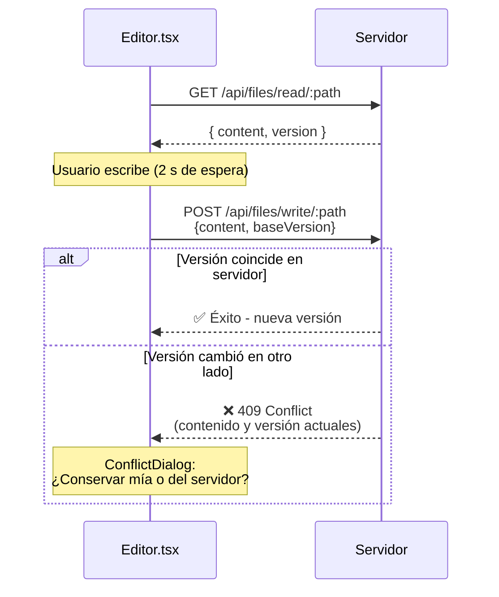

# 🏗️ Arquitectura de Obsidita

## 📋 Tabla de contenidos

- [Visión general](#visión-general)
- [Stack tecnológico](#stack-tecnológico)
- [Estructura del proyecto](#estructura-del-proyecto)
- [Arquitectura de capas](#arquitectura-de-capas)
- [Flujo de datos](#flujo-de-datos)
- [Componentes principales](#componentes-principales)
- [API Backend](#api-backend)
- [Sistema de autenticación](#sistema-de-autenticación)
- [Guía de desarrollo](#guía-de-desarrollo)
- [Convenciones y patrones](#convenciones-y-patrones)

---

## 🎯 Visión general

**Obsidita** es una aplicación web completa que permite visualizar, editar y sincronizar bóvedas de [Obsidian](https://obsidian.md/) a través del navegador. Combina un frontend moderno basado en React con un backend robusto en Node.js/Express.

```
┌─────────────────────────────────────────────────────┐
│              🌐 Navegador Web                        │
├─────────────────────────────────────────────────────┤
│  React App (Vite) - TypeScript - Zustand State      │
│  - Editor (CodeMirror)                              │
│  - Visor de Markdown                                │
│  - Explorador de archivos                           │
│  - Panel de búsqueda                                │
│  - Sistema de tareas                                │
└────────────────┬────────────────────────────────────┘
                 │ API REST + WebSockets
                 │ (JSON, cookies de sesión)
                 ▼
┌─────────────────────────────────────────────────────┐
│         📦 Backend Node.js/Express                  │
├─────────────────────────────────────────────────────┤
│  - Rutas de autenticación                           │
│  - Gestión de archivos y bóveda                     │
│  - Sistema de búsqueda                              │
│  - Sincronización (GitHub/Dropbox)                  │
│  - Sesiones y seguridad                             │
│  - Gestión de fuentes tipográficas                  │
└────────────────┬────────────────────────────────────┘
                 │ Lectura/Escritura
                 │ de archivos
                 ▼
┌─────────────────────────────────────────────────────┐
│      💾 Sistema de archivos / Bóveda Obsidian      │
│  ├── /notes        (archivos .md)                   │
│  ├── /.obsidian    (configuración)                  │
│  └── /attachments  (imágenes y archivos)            │
└─────────────────────────────────────────────────────┘
```

---

## 🛠️ Stack tecnológico

### Frontend
| Tecnología | Propósito | Versión |
|-----------|----------|---------|
| **React** | Librería de UI | 18.2.0 |
| **TypeScript** | Tipado estático | 5.0.0 |
| **Vite** | Bundler y dev server | 6.4.4 |
| **Zustand** | Gestión de estado global | 4.4.0 |
| **CodeMirror** | Editor de código/markdown | 6.x |
| **markdown-it** | Parser de Markdown | 15.0.2 |
| **Mermaid** | Diagramas en Markdown | 11.17.2 |

### Backend
| Tecnología | Propósito |
|-----------|----------|
| **Node.js** | Runtime (>=20.0.0) |
| **Express** | Framework web |
| **cookie-parser** | Gestión de cookies |
| **archiver** | Compresión de archivos |
| **highlight.js** | Resaltado de sintaxis |

### Herramientas de desarrollo
- **concurrently** - Ejecutar dev server frontend y backend simultaneamente
- **@types/react** - Definiciones de tipos para React
- **ESM modules** - Módulos ES6 nativos

---

### 📦 Gestión de dependencias

> **⚠️ Importante:** Todas las dependencias están en el `package.json` de la raíz. El frontend se compila con Vite en el `postinstall`, por eso **las dependencias de desarrollo son necesarias también en producción**.

Esto significa que:
- `npm install --omit=dev` **NO** funcionará correctamente
- Debes hacer `npm install` (incluyendo devDependencies) también en producción
- El directorio `web/` tiene su propio `package.json` pero las dependencias se resuelven desde la raíz
- El script `postinstall` automáticamente ejecuta `npm run web:build` después de instalar

Flujo en instalación:
```bash
npm install
  ↓
npm run postinstall
  ↓
cd web && vite build    # Compila el frontend
  ↓
Frontend listo para servir desde dist/
```

---

## 📁 Estructura del proyecto

```
Obsidian-Web/
├── 📄 package.json           # Dependencias y scripts
├── 📄 ARQUITECTURA.md        # Este archivo
│
├── 🌐 web/                   # Frontend (React + Vite + TypeScript)
│   ├── src/
│   │   ├── components/       # Componentes React reutilizables
│   │   │   ├── App.tsx       # Punto de entrada
│   │   │   ├── MainLayout.tsx# Layout principal (editor, sidebar, etc)
│   │   │   ├── Editor.tsx    # Editor con CodeMirror
│   │   │   ├── ReadingView.tsx# Visor de markdown renderizado
│   │   │   ├── FileExplorer.tsx# Árbol de archivos
│   │   │   ├── SearchPanel.tsx# Búsqueda full-text
│   │   │   ├── SettingsModal.tsx# Configuración de usuario
│   │   │   ├── Setup.tsx     # Wizard de setup inicial
│   │   │   ├── Login.tsx     # Pantalla de autenticación
│   │   │   └── [otros]       # TagsPanel, NoteMenu, ImageViewer, etc
│   │   │
│   │   ├── store.ts          # Estado global (Zustand)
│   │   ├── api.ts            # Cliente HTTP para comunicación backend
│   │   ├── main.tsx          # Punto de entrada de la app
│   │   │
│   │   ├── i18n/             # Internacionalización
│   │   │   ├── index.tsx     # Contexto y hooks de i18n
│   │   │   ├── en.ts         # Traducciones inglés
│   │   │   └── es.ts         # Traducciones español
│   │   │
│   │   ├── utils/            # Funciones auxiliares
│   │   │   ├── wikilinks.ts  # Procesamiento de [[wikilinks]]
│   │   │   ├── frontmatter.ts# Parse de YAML frontmatter
│   │   │   ├── attachments.ts# Manejo de archivos adjuntos
│   │   │   ├── imageUpload.ts# Upload de imágenes
│   │   │   ├── mermaidDiagrams.ts# Rendering de diagramas
│   │   │   ├── livePreview.ts# Actualización en vivo del preview
│   │   │   ├── codeHighlight.ts# Resaltado de código
│   │   │   ├── mobile.ts     # Detección y soporte móvil
│   │   │   └── [otros]       # fonts, toast, templates, etc
│   │   │
│   │   └── styles/           # CSS global y temas
│   │
│   ├── public/               # Assets estáticos
│   ├── dist/                 # Build output (generado)
│   ├── vite.config.ts        # Configuración de Vite
│   ├── tsconfig.json         # Configuración de TypeScript
│   └── package.json
│
├── 🔧 server/                # Backend (Node.js + Express)
│   ├── index.js              # Punto de entrada, configuración de Express
│   │
│   ├── core/                 # Lógica core
│   │   ├── vault.js          # Gestión de la bóveda (lectura/escritura)
│   │   ├── sync.js           # Motor de sincronización (GitHub, Dropbox)
│   │   ├── sessions.js       # Almacenamiento de sesiones
│   │   ├── searchIndex.js    # Índice de búsqueda full-text
│   │   └── links.js          # Análisis y cálculo de relaciones
│   │
│   ├── routes/               # Endpoints de la API
│   │   ├── auth.js           # POST /login, /logout, /change-password
│   │   ├── files.js          # GET/POST /notes, /attachments, /tree
│   │   ├── search.js         # GET /search?q=
│   │   ├── settings.js       # GET/POST /settings, /fonts
│   │   ├── sync.js           # POST /sync, /sync-status
│   │   ├── setup.js          # GET /setup, POST /setup
│   │   └── fonts.js          # GET /fonts/:name
│   │
│   ├── middleware/           # Middlewares de Express
│   │   ├── security.js       # CSRF, headers de seguridad, límites
│   │   ├── password.js       # Protección de endpoints sensibles
│   │   └── env.js            # Variables de entorno
│   │
│   ├── utils/                # Funciones auxiliares
│   │   ├── limits.js         # Límites de tamaño
│   │   ├── updates.js        # Gestión de actualizaciones
│   │   └── lazy.js           # Lazy loading de módulos
│   │
│   └── .env                  # Variables de entorno (no versionado)
│
├── 💾 data/                  # Almacenamiento local (no versionado)
│   ├── .secret               # Secret para firmar cookies
│   ├── .password             # Hash de la contraseña
│   ├── sessions.json         # Sesiones activas
│   ├── config.json           # Configuración guardada
│   ├── ai.json               # Configuración de IA
│   └── [vault]               # Bóveda de Obsidian
│       ├── notes/            # Archivos .md
│       ├── .obsidian/        # Configuración de Obsidian
│       └── attachments/      # Imágenes y otros archivos
│
└── 📚 utils/                 # Scripts y documentación
    ├── ESP/                  # Documentación en español
    │   ├── ERRORES_Y_SOLUCIONES.md
    │   └── [otras guías]
    └── [scripts útiles]
```

---

## 🏛️ Arquitectura de capas

### Capa de Presentación (Frontend)

**Responsabilidades:**
- Renderizar UI React
- Gestionar estado del usuario
- Capturar entrada del usuario
- Comunicarse con el backend

**Componentes clave:**
- `App.tsx` - Manejo del ciclo de vida (Setup → Login → Main)
- `MainLayout.tsx` - Layout principal con editor, sidebar, comandos
- `Editor.tsx` - Integración con CodeMirror
- `ReadingView.tsx` - Rendering de markdown procesado

**Estado global (Zustand):**
```typescript
// store.ts
{
  // Estructura de carpetas/archivos
  tree: FileNode[],
  
  // Archivo abierto
  currentNote: Note,
  content: string,
  
  // Interfaz
  sidebarCollapsed: boolean,
  theme: 'light' | 'dark',
  
  // Búsqueda
  searchResults: Note[],
}
```

---

### Capa de Lógica de Negocios (Backend)

**Responsabilidades:**
- Validar y autorizar requests
- Ejecutar operaciones sobre la bóveda
- Mantener la sincronización
- Gestionar la búsqueda

**Flujo típico de una request:**

```
1. Cliente hace request a POST /api/notes/save
                    ↓
2. Middleware de seguridad (CSRF, headers)
                    ↓
3. Autenticación (verificar cookie de sesión)
                    ↓
4. Autorización (usuario autenticado)
                    ↓
5. Validación de datos (máximo tamaño, etc)
                    ↓
6. Operación en vault (lectura/escritura de archivos)
                    ↓
7. Actualizar índice de búsqueda
                    ↓
8. Responder al cliente
```

---

### Capa de Datos (Almacenamiento)

**Sistema de archivos:**
```
data/
├── [vault-name]/
│   ├── notes/          # Archivos markdown (.md)
│   ├── attachments/    # Imágenes, PDFs, etc
│   └── .obsidian/      # Config de Obsidian
├── config.json         # Configuración (vault path, etc)
├── sessions.json       # Sesiones activas
├── ai.json            # Configuración de IA
├── .password          # Hash bcrypt de la contraseña
└── .secret            # Secret para firmar cookies
```

---

## 🔄 Flujo de datos

### Ciclo de edición: Usuario edita un archivo

```
┌──────────────────────────────────────────────────────────────┐
│ 1️⃣  Usuario escribe en CodeMirror                            │
└──────────────────────────────────────────────────────────────┘
                           ↓
┌──────────────────────────────────────────────────────────────┐
│ 2️⃣  Evento onChange dispara debounce (500ms)                 │
└──────────────────────────────────────────────────────────────┘
                           ↓
┌──────────────────────────────────────────────────────────────┐
│ 3️⃣  Guardar en store local (Zustand)                         │
│     - Mostrar indicador "Sin guardar"                        │
│     - Actualizar preview en vivo                             │
└──────────────────────────────────────────────────────────────┘
                           ↓
┌──────────────────────────────────────────────────────────────┐
│ 4️⃣  POST /api/notes/:path con content                        │
│     Header: { 'X-CSRF-Token': ... }                          │
│     Body: { content: string }                                │
└──────────────────────────────────────────────────────────────┘
                           ↓
         ┌─────────────────┴─────────────────┐
         ▼                                   ▼
    ✅ Éxito                           ❌ Error
    - Status 200                       - Toast de error
    - Guardar en archivo               - Reintentar
    - Actualizar índice                - Mostrar conflicto
    - Responder al cliente
         │                                   │
         └─────────────────┬─────────────────┘
                           ▼
┌──────────────────────────────────────────────────────────────┐
│ 5️⃣  Cliente actualiza estado                                 │
│     - Limpiar indicador "Sin guardar"                        │
│     - Mostrar última hora de guardado                        │
└──────────────────────────────────────────────────────────────┘
```

### Ciclo de sincronización automática

```
Cada 5 minutos (configurable):

┌──────────────────────────────────────────────────────────────┐
│ SyncManager verifica si hay cambios en GitHub/Dropbox        │
└──────────────────────────────────────────────────────────────┘
                           ↓
    ┌──────────────────────┴──────────────────────┐
    ▼                                             ▼
Cambios remotos                           Sin cambios remotos
    │                                             │
    ├─ Descargar archivos                        └─ Esperar
    ├─ Mergear cambios
    ├─ Actualizar índice
    └─ Notificar al cliente
```

---

## 🔄 Flujos principales

### Arranque y autenticación

1. **Inicio del servidor** (`server/index.js`):
   - Crea `data/` con permisos `700` (solo usuario)
   - Carga o genera `data/.secret` para firmar las cookies
   - Monta todas las rutas de la API

2. **Primera configuración** (sin `data/config.json`):
   - `routes/setup.js` genera un **token de un solo uso** e imprime en consola
   - En el navegador, `App.tsx` llama a `GET /api/setup/status`
   - Si no está configurado → muestra `Setup.tsx`
   - Usuario hace `POST /api/setup/init` con: token, ruta del vault, contraseña
   - Servidor valida la ruta y guarda hash **scrypt** en `data/config.json`

3. **Login en sesiones posteriores**:
   - `App.tsx` llama `GET /api/setup/status`
   - Si está configurado e intenta `GET /api/files/tree`
   - Si responde `401` → muestra `Login.tsx`
   - Usuario entra credencial en `POST /api/auth/login`
   - Servidor verifica contraseña y crea sesión:
     - Cookie firmada `session=<token>` (HttpOnly, Secure, SameSite=Strict)
     - En `data/sessions.json` guarda hash SHA-256 del token (nunca en claro)

4. **Middleware de autenticación**:
   - Todo `/api` salvo `setup` y `auth` pasa por validación de sesión
   - `getConfig()` relee `data/config.json` en cada request
   - Cambios de vault se aplican **al instante**

---

### Abrir y guardar una nota

**Flujo con detección de conflictos:**



**Detalles importantes:**

- `MainLayout.tsx` carga nota al cambiar pestaña y guarda versión en `noteVersions`
- **Autoguardado**: 2 segundos sin escribir; `Ctrl+S` lo adelanta
- Antes de renombrar, mover o borrar → se vacían guardados pendientes
- `vault.writeFile` solo escribe si versión del disco = `baseVersion`
- Si no coincide → lanza `ConflictError` → respuesta `409`
- El cliente abre `ConflictDialog` para resolver

---

### Detectar cambios hechos fuera de la pestaña

`MainLayout.tsx` vuelve a leer la nota abierta:
- **Cada 15 segundos** mientras la pestaña está visible
- Al volver a ella (cambio de foco)
- Al recibir evento `NOTES_CHANGED` (desde sincronización)

**Lógica:**
- Si versión cambió y **no hay** cambios sin guardar → sustituye contenido
- Si **hay** cambios sin guardar → espera al guardado para detectar conflicto

---

### Renombrar y mover archivos

`POST /api/files/rename` ejecuta en dos fases:

1. **Fase 1 - Antes de mover** (`links.prepareLinkUpdate`):
   - Resuelve cada enlace del vault con el **árbol antiguo**
   
2. **Fase 2 - Después de mover**:
   - Reescribe enlaces que ya no llegan a su destino:
     - `[[wikilinks]]` 
     - `![[incrustaciones de notas]]`
     - `[enlaces](markdown)`
   - Devuelve lista de notas modificadas (`{ updated }`)
   - Cliente lanza `NOTES_CHANGED` para recargar nota abierta e incrustaciones

> **⚠️ Importante:** Resolución de wikilinks está **duplicada**:
> - Cliente: `web/src/wikilinks.ts`
> - Servidor: `server/links.js`
> 
> **Deben comportarse IGUAL:** ruta exacta → relativa a la nota → por nombre en cualquier carpeta (la más cercana). Si cambias una, cambia la otra.

---

### Modo lectura e incrustaciones

`ReadingView.tsx` renderiza markdown con reglas propias:

**Sintaxis soportada:**
- `[[wikilinks]]` - Atenuados si no existen
- `![[imagen]]` - Con detección automática de tamaño
- `![[nota]]` / `![[nota#encabezado]]` - Incrustación de notas completas
- `> [!tipo]` - Callouts (info, warning, etc)
- `==resaltado==` - Highlighting de texto
- `#etiquetas` - Tags procesados
- Bloques de código con botón copiar y resaltado con highlight.js
- ` ```mermaid ` - Diagramas convertidos automáticamente

**Lazy loading:**
- `markdown-it` renderiza **sincronamente** (sin await)
- Notas incrustadas se piden en **background** a `noteEmbeds.ts`
- Al llegar la respuesta, avisa con `useSyncExternalStore` y se repinta
- **Límite de profundidad:** máximo 4 niveles
- **Protección contra bucles:** una nota no puede incrustarse a sí misma

**Seguridad de Mermaid:**
- Usa `securityLevel: 'strict'` (etiquetas saneadas, sin JS)
- SVGs se cachean por tema
- CSP permite `style-src 'unsafe-inline'` (Mermaid mete `<style>` en cada SVG)
- No usa `eval`, así que `script-src` no cambia

---

### Búsqueda y etiquetas

`routes/search.js` busca sobre **índice en memoria** (`searchIndex.js`):

**Cómo funciona el índice:**
- En cada búsqueda se **recorre el árbol** (solo `stat`)
- Se relectan **solo** archivos cuya fecha o tamaño cambiaron
- Recoge cambios desde: web, GitHub sync, cambios externos (sin vigilar carpeta)
- Se construye en **primera búsqueda**

**Características:**
- `q=texto` - Búsqueda full-text
- `tag:etiqueta` - Busca en frontmatter `tags` y en `#etiquetas` del cuerpo (fuera de código)
- `GET /api/search/tags` - Todas las etiquetas con sus notas
- Tags se calculan **una vez por versión**
- Límites aplican: tamaño archivo, total indexado, resultados, coincidencias, rate limit

---

### Papelera

`vault.deleteFile` mueve a `.trash/` con nombre: `nombre.ext.<timestamp>.deleted`

**Cómo funciona:**
- Ruta original se guarda en `.trash/.index.json`
- `TrashPanel.tsx` permite:
  - Restaurar a ruta original
  - Borrar definitivamente
  - Vaciar toda la papelera

> **Nota:** Operaciones de papelera van por `POST` (no `DELETE`) para no chocar con `DELETE /api/files/:filePath` cuando una nota se llama `trash`

---

### Sincronización con GitHub

`server/sync.js` ejecuta git de forma segura:

**Proceso de sincronización:**
1. Commit cambios locales
2. `fetch` desde remoto
3. `rebase -X theirs` sobre rama remota (el servidor gana en conflictos)
4. Si falla → `rebase --abort`
5. `push` de cambios

**Seguridad:**
- Git ejecutado con `spawn` (sin shell)
- Configuración de git en **variables de entorno** (`GIT_CONFIG_*`)
- Token viaja como `extraHeader`, **nunca en URL ni en `.git/config`**
- Token eliminado de mensajes de error
- Solo permite `https://github.com/`
- Sin hooks de git ni `core.fsmonitor`

**Historial de versiones:**
- `GET /api/sync/history?path=...` - Commits que tocaron la nota (hasta 200)
- Sigue renombrados automáticamente con `--follow`
- `GET /api/sync/history/version?path=&commit=...` - Contenido en ese commit + diff
- Rutas seguras con `GIT_LITERAL_PATHSPECS=1`
- Commit pedido debe estar en historial de la nota
- `HistoryDialog` (en menú de nota) muestra y permite restaurar

**Temporizador:**
- Comprueba cada minuto si toca sincronización periódica según `interval`
- Configurable en `POST /api/sync/config`

---

## 🧩 Componentes principales

### Frontend Components

#### `MainLayout.tsx`
Layout principal que contiene:
- **Ribbon** (izquierda) - Botones de comandos rápidos
- **FileExplorer** (izquierda-centro) - Árbol de archivos
- **Editor** (centro) - CodeMirror o ReadingView
- **StatusBar** (abajo) - Información: palabras, línea actual, guardado
- **Modal System** - Overlays para settings, diálogos, etc

```
┌───────────────────────────────────────────────────┐
│ TopBar (título, comandos globales)               │
├────────┬──────────────────────────┬──────────────┤
│ Ribbon │  FileExplorer            │              │
│        │  ┌──────────────────┐    │              │
│ [🔍]   │  │ 📁 folder        │    │              │
│ [📝]   │  │ ├─ 📄 file1.md   │    │  Editor      │
│ [⚙️]   │  │ ├─ 📄 file2.md   │    │  (CM or RV)  │
│ [📊]   │  │ └─ 📁 subfolder  │    │              │
│        │  └──────────────────┘    │              │
├────────┴──────────────────────────┴──────────────┤
│ StatusBar: "10 words | Line 5:12 | Saved"       │
└───────────────────────────────────────────────────┘
```

#### `Editor.tsx`
Integración con CodeMirror6:
- Syntax highlighting para Markdown
- Autocompletado de wikilinks
- Búsqueda y reemplazo
- Tema basado en preferencias del usuario
- Sincronización con estado global

#### `ReadingView.tsx`
Rendering de Markdown procesado:
- Parse con markdown-it
- Resaltado de código con highlight.js
- Rendering de diagramas Mermaid
- Manejo de wikilinks clicables
- Renderizado de embeds de notas

#### `FileExplorer.tsx`
Árbol de archivos interactivo:
- Exploración recursiva de carpetas
- Crear/renombrar/eliminar archivos
- Drag-and-drop
- Search filter
- Menú contextual

### Backend Modules

#### `vault.js` - Gestor de la bóveda

```javascript
// Operaciones principales
readNote(path)           // Leer contenido de nota
writeNote(path, content) // Guardar nota
deleteNote(path)         // Eliminar nota
listFiles(path)          // Listar archivos en carpeta
createFolder(path)       // Crear carpeta
getVaultStructure()      // Árbol completo
```

#### `searchIndex.js` - Búsqueda full-text

```javascript
// Índice invertido en memoria
{
  noteIndex: {
    "search": [
      { file: "notes/dev.md", score: 0.95 },
      { file: "notes/tips.md", score: 0.87 }
    ]
  },
  
  tagIndex: {
    "#python": ["notes/dev.md", "notes/tips.md"]
  }
}

// API
search(query)      // Búsqueda por contenido
searchTags(tag)    // Notas con un tag específico
rebuildIndex()     // Reconstruir después de cambios
```

#### `sync.js` - Sincronización

```javascript
// Soporta múltiples proveedores
- GitHub (a través de API)
- Dropbox (a través de API)
- Google Drive (futuro)

// Operaciones
sync()             // Sincronizar cambios
getStatus()        // Ver estado de sincronización
setProvider(...)   // Configurar proveedor
```

#### `sessions.js` - Gestión de sesiones

```javascript
// Almacenamiento en disco
data/sessions.json = {
  "session-token": {
    userId: 1,
    createdAt: timestamp,
    expiresAt: timestamp,
    ip: "192.168.1.1"
  }
}

// API
createSession()    // Crear sesión tras login
validateSession()  // Validar en cada request
destroySession()   // Logout
cleanupExpired()   // Limpiar sesiones expiradas (diario)
```

---

## 🔌 API Backend

**Todas las rutas cuelgan de `/api`.** Salvo `setup` y `auth`, exigen una sesión válida (si no, devuelven `401`). Las peticiones que no son `GET` pasan la protección CSRF (header `X-CSRF-Token`).

**`:filePath`** es la ruta relativa al vault, codificada como un solo segmento de URL.

---

### Tabla de endpoints

| Método | Ruta | Descripción |
| :---: | :--- | :--- |
| `GET` | `/api/setup/status` | Verifica si está configurado. Responde `{ configured }` |
| `POST` | `/api/setup/init` | **Configuración inicial** - `setupToken`, `vaultPath`, `password`, `port` |
| `POST` | `/api/auth/login` | Inicia sesión (`password`). Set-Cookie: `session=...` |
| `POST` | `/api/auth/logout` | Cierra la sesión actual |
| `GET` | `/api/files/tree` | Árbol del vault (lista plana de `{ type, path, name, size?, modified? }`) |
| `GET` | `/api/files/read/:filePath` | Contenido de una nota y su versión (`{ content, version }`) |
| `GET` | `/api/files/raw/:filePath` | Archivo binario (imágenes, adjuntos) |
| `GET` | `/api/files/export-pdf/:filePath` | Versión imprimible (PDF) de la nota |
| `POST` | `/api/files/write/:filePath` | Guarda una nota (`{ content, baseVersion? }`). Devuelve `409` si conflicto de versión |
| `POST` | `/api/files/upload?note=…&name=…` | Sube adjunto (cuerpo binario); devuelve `{ path }` |
| `DELETE` | `/api/files/:filePath` | Mueve a `.trash/` |
| `GET` | `/api/files/trash` | Contenido de la papelera |
| `POST` | `/api/files/trash/restore` | Restaura a su ruta original (`{ id }`) |
| `POST` | `/api/files/trash/delete` | Borra definitivamente (`{ id }`) |
| `POST` | `/api/files/trash/empty` | Vacía toda la papelera |
| `POST` | `/api/files/rename` | Renombra o mueve (`{ oldPath, newPath }`), actualiza enlaces; devuelve `{ updated }` |
| `POST` | `/api/files/copy` | Duplica una nota (`{ path }`) |
| `POST` | `/api/files/create-note` | Crea nota vacía (`{ path, content? }`) |
| `POST` | `/api/files/create-folder` | Crea carpeta (`{ path }`) |
| `GET` | `/api/search?q=…` | Búsqueda full-text o `tag:etiqueta` |
| `GET` | `/api/search/tags` | Todas las etiquetas del vault (`{ tag, paths }[]`) |
| `GET` `POST` | `/api/settings/vault` | Lee / cambia ruta del vault (`{ vaultPath, password }`) |
| `GET` | `/api/settings/limits` | Límites actuales del servidor (solo lectura) |
| `POST` | `/api/settings/password` | Cambia contraseña (`{ currentPassword, newPassword }`) |
| `POST` | `/api/settings/sessions/revoke` | Cierra todas las sesiones excepto la actual |
| `GET` `POST` | `/api/settings/attachments` | Lee / cambia `{ attachmentFolderPath }` |
| `GET` `POST` | `/api/settings/notes` | Lee / cambia `{ dailyNotes, templates }` |
| `GET` | `/api/sync` | Config y estado de sincronización (`{ hasToken }`) |
| `POST` | `/api/sync/config` | Cambia config (`{ provider, interval, github }`) |
| `POST` | `/api/sync/run` | Sincroniza ahora; devuelve estado |
| `GET` | `/api/sync/history?path=` | Commits que han tocado la nota |
| `GET` | `/api/sync/history/version?path=&commit=` | Contenido y diff en ese commit |

---

### Detalles de endpoints importantes

#### Setup y autenticación

**`POST /api/setup/init`** - Solo accesible si no está configurado
```javascript
Body: {
  setupToken: string,        // Token de seguridad
  vaultPath: string,         // Ruta al vault de Obsidian
  password: string,          // Contraseña inicial
  port: number              // Puerto (ej: 3000)
}

Response: { success: true }
```

**`POST /api/auth/login`** - Inicia sesión
```javascript
Body: { password: string }

Response: {
  success: true,
  user: { /* info del usuario */ }
}
Header: Set-Cookie: session=<token>; HttpOnly; Secure; SameSite=Strict
```

---

#### Gestión de archivos

**`GET /api/files/tree`** - Estructura completa
```javascript
Response: [
  { type: "folder", path: "notes", name: "notes" },
  { type: "file", path: "notes/Welcome.md", name: "Welcome.md", size: 2048, modified: 1697... },
  { type: "file", path: "notes/Archive.md", name: "Archive.md", size: 1024, modified: 1696... }
]
```

**`GET /api/files/read/:filePath`** - Leer nota
```javascript
// GET /api/files/read/notes%2FWelcome.md

Response: {
  content: "# Welcome\n\n...",
  version: "abc123def456"  // Para control de conflictos
}
```

**`POST /api/files/write/:filePath`** - Guardar con control de versión
```javascript
// POST /api/files/write/notes%2FWelcome.md

Body: {
  content: "# Welcome\n\n...",
  baseVersion: "abc123def456"  // Opcional: detectar conflictos
}

Response (éxito): { success: true }
Response (conflicto): { 
  error: "Version conflict",
  status: 409,
  currentVersion: "xyz789..."
}
```

**`POST /api/files/upload?note=notes/Welcome&name=image.png`** - Subir adjunto
```javascript
Body: [binario de imagen]

Response: {
  path: "attachments/image-20240115-abc123.png",
  url: "/api/files/raw/attachments/image-20240115-abc123.png"
}
```

**`POST /api/files/rename`** - Renombrar y actualizar enlaces
```javascript
Body: {
  oldPath: "notes/OldName.md",
  newPath: "notes/NewName.md"
}

Response: {
  updated: [
    "notes/ReferringNote.md"  // Notas que tenían [[OldName]]
  ]
}
```

---

#### Búsqueda

**`GET /api/search?q=typescript`** - Búsqueda full-text
```javascript
Response: {
  results: [
    {
      path: "notes/dev.md",
      name: "dev.md",
      excerpt: "...TypeScript is a typed superset...",
      score: 0.95
    }
  ],
  total: 5
}
```

**`GET /api/search/tags`** - Todas las etiquetas
```javascript
Response: [
  { tag: "python", paths: ["notes/dev.md", "notes/tips.md"] },
  { tag: "javascript", paths: ["notes/dev.md"] },
  { tag: "archivado", paths: ["notes/old.md"] }
]
```

---

#### Sincronización con GitHub

**`POST /api/sync/config`** - Configurar sincronización
```javascript
Body: {
  provider: "github",        // "github" | "none"
  interval: 300000,          // ms entre syncs automáticos
  github: {
    token: "ghp_xxxxx...",   // Token de GitHub
    owner: "usuario",
    repo: "mi-vault",
    branch: "main"
  }
  // Para eliminar token: github: { token: null }
}

Response: { success: true }
```

**`POST /api/sync/run`** - Sincronizar ahora
```javascript
Response: {
  success: true,
  lastSync: 1697xxx,
  commits: 5,
  error: null
}
```

**`GET /api/sync/history?path=notes/dev.md`** - Historial de commits
```javascript
Response: [
  {
    date: "2024-01-15T10:30:00Z",
    author: "John Doe",
    message: "Update dev notes",
    path: "notes/dev.md"  // Ruta en ese commit
  },
  // ... más commits
]
```

**`GET /api/sync/history/version?path=notes/dev.md&commit=abc123`** - Contenido en commit
```javascript
Response: {
  content: "# Dev Notes\n\n...",  // Contenido en ese commit
  diff: "- Viejo contenido\n+ Nuevo contenido"
}
```

---

#### Configuración

**`POST /api/settings/password`** - Cambiar contraseña
```javascript
Body: {
  currentPassword: "actual",
  newPassword: "nueva"
}

Response: { success: true }
```

**`POST /api/settings/sessions/revoke`** - Cerrar todas las sesiones
```javascript
Response: { success: true }  // Excepto la sesión actual
```

---

### Códigos de respuesta HTTP

| Código | Significado |
|--------|-----------|
| `200` | Éxito |
| `400` | Datos inválidos (validación fallida) |
| `401` | No autenticado (sesión expirada/inválida) |
| `403` | No autorizado o CSRF inválido |
| `404` | Recurso no encontrado |
| `409` | Conflicto (ej: versión de nota ha cambiado) |
| `413` | Payload muy grande (excede límites) |
| `500` | Error interno del servidor |

---

## 🔐 Sistema de autenticación

### Flujo de autenticación

```
1️⃣  Setup (primera vez)
    POST /api/setup
    ├─ Crear directorio data/
    ├─ Generar secret para cookies
    ├─ Hash de contraseña con bcrypt
    └─ Guardar en data/.password

2️⃣  Login
    POST /api/login { password }
    ├─ Comparar hash con bcrypt
    ├─ Si coincide: crear sesión
    ├─ Guardar en data/sessions.json
    ├─ Set cookie: session=<token> (httpOnly, Secure, SameSite)
    └─ Responder 200 OK

3️⃣  Requests autenticados
    GET /api/notes/tree
    ├─ Validar cookie de sesión
    ├─ Buscar en data/sessions.json
    ├─ Verificar expiración
    ├─ Si válida: continuar
    └─ Si inválida: responder 401 Unauthorized

4️⃣  Logout
    POST /api/logout
    ├─ Eliminar sesión de data/sessions.json
    ├─ Clear cookie
    └─ Responder 200 OK
```

### Seguridad

**Contraseñas:**
- Hash bcrypt (salt rounds: 10)
- Nunca en plain text
- Almacenadas en `data/.password` con permisos 0600

**Sesiones:**
- Token aleatorio de 32 bytes (hex)
- Almacenadas en JSON (podrían migrarse a BD)
- Expiración: 7 días configurable
- Cookie httpOnly (no accesible desde JS)
- Cookie Secure (solo HTTPS en producción)
- Cookie SameSite=Strict (CSRF protection)

**CSRF:**
- Token en cada formulario
- Validación en middleware
- Headers: X-CSRF-Token

**Permisos de archivos:**
- `data/` → 0700 (solo user)
- Archivos en `data/` → 0600
- Vault → 0755 (user + grupo si es necesario)

---

### Medidas de seguridad en el código

Si tocas alguno de estos archivos, **revisa que la medida sigue en pie:**

| Medida | Dónde |
| :--- | :--- |
| Rutas dentro del vault, sin `../`, sin symlinks hacia fuera, `.obsidian/` y `.git/` protegidas | `server/vault.js` → `guardPath()`. **Toda** ruta que llega del cliente debe pasar por aquí. |
| Rutas válidas para un vault (sin carpetas del sistema ni de la app, `VAULTS_ROOT`) | `server/vault.js` → `checkVaultPath()` |
| CSP, HSTS, X-Frame-Options, X-Content-Type-Options; hashes CSP de los scripts en línea | `server/security.js` → `securityHeaders()` |
| CSRF (validación de `Sec-Fetch-Site` y `Origin`) | `server/security.js` → `csrfGuard` |
| Errores sin rutas internas ni trazas | `server/security.js` → `publicError()` y manejador de errores en `server/index.js` |
| Sesiones revocables y límite de intentos de login | `server/sessions.js` |
| Contraseñas con scrypt (no bcrypt), comparación en tiempo constante | `server/password.js` |
| Git sin hooks ni `core.fsmonitor`, solo `https://github.com/`, token nunca en URL/config | `server/sync.js` |
| Archivos del vault servidos con CSP *sandbox* (SVG) | `server/routes/files.js` → `/raw` |

---

### Archivos de datos

La carpeta `data/` se crea automáticamente, está en `.gitignore` y el servidor ajusta permisos al arrancar.

| Archivo | Contenido |
| :--- | :--- |
| `config.json` | `vaultPath`, `passwordHash` (scrypt: 16 bytes sal + 32 hash, hex), `port`, `createdAt`. **Se relee en cada petición.** |
| `.secret` | Secret aleatorio que firma las cookies. Si se borra, se genera otro y todas las sesiones dejan de valer. |
| `sessions.json` | Hashes SHA-256 de sesiones activas (nunca tokens en claro), caducidad y última actividad. Actividad se guarda en disco **como mucho una vez por hora**. |
| `sync.json` | Config de sincronización con GitHub, último estado y token (si existe). |

**Dentro del vault, la app solo usa:**

| Ruta | Uso |
| :--- | :--- |
| `.trash/` | Papelera: `nombre.ext.<timestamp>.deleted` con rutas originales en `.trash/.index.json` |
| `.obsidian/app.json` | Solo clave `attachmentFolderPath` (carpeta de adjuntos) |
| `.obsidian/daily-notes.json` | Claves `folder`, `format`, `template` (notas diarias) |
| `.obsidian/templates.json` | Claves `folder`, `dateFormat`, `timeFormat` (plantillas) |
| `.git/` | Solo con sincronización GitHub: repo local (se crea si no existe) |

---

## 🚀 Guía de desarrollo

### Instalación local

```bash
# Clonar repositorio
git clone <repo>
cd Obsidian-Web

# Instalar dependencias
npm install

# Configurar variables de entorno
cp .env.example .env
# Editar .env con tu configuración
```

### Modo desarrollo

```bash
# Ejecutar frontend (Vite) y backend (Node) en paralelo
npm run dev

# O por separado:
npm run web:dev          # Frontend: http://localhost:5173
npm run server:dev       # Backend: http://localhost:3000
```

### Build para producción

```bash
# Compilar frontend (Vite)
npm run web:build

# Iniciar servidor de producción
npm start
```

### Estructura de una request típica

#### Agregar un nuevo endpoint GET `/api/notes/related`

**Backend:**

```javascript
// server/routes/files.js
router.get('/related', requireAuth, async (req, res) => {
  try {
    const noteLinks = await vault.getRelatedNotes(req.query.path);
    res.json(noteLinks);
  } catch (err) {
    res.status(500).json({ error: err.message });
  }
});
```

**Frontend:**

```typescript
// web/src/api.ts
export const filesApi = {
  async getRelatedNotes(path: string) {
    const res = await fetch(`/api/notes/related?path=${encodeURIComponent(path)}`);
    if (!res.ok) throw new Error('Failed to fetch related notes');
    return res.json();
  }
};

// web/src/components/SidePanel.tsx
import { filesApi } from '../api';
const related = await filesApi.getRelatedNotes(currentNote.path);
```

---

### Testing (cuando lo haya)

```bash
# Tests unitarios
npm run test

# Tests e2e
npm run test:e2e

# Coverage
npm run test:coverage
```

---

## 📐 Convenciones y patrones

### Naming

**Archivos:**
- Componentes React: `PascalCase.tsx` (ej: `FileExplorer.tsx`)
- Funciones/módulos: `camelCase.js` (ej: `vault.js`)
- Hooks personalizados: `useXxx.ts` (ej: `useSearch.ts`)
- Constantes: `UPPER_SNAKE_CASE` (ej: `MAX_NOTE_MB`)

**Variables:**
- `const` por defecto (inmutabilidad)
- `currentNote` para el archivo abierto actualmente
- `tree` para la estructura de archivos
- `content` para el contenido de un archivo

**Funciones async:**
```typescript
// ✅ Bueno
async function fetchUserData(id) {
  try {
    const response = await api.getUser(id);
    return response.data;
  } catch (error) {
    logError(error);
    throw error;
  }
}

// ❌ Evitar
function fetchUserData(id) {
  return api.getUser(id).then(...).catch(...);
}
```

### Manejo de errores

**Frontend:**
```typescript
try {
  const result = await filesApi.saveNote(path, content);
  showToast('Guardado!', 'success');
} catch (error) {
  const message = error instanceof Error ? error.message : 'Error desconocido';
  showToast(message, 'error');
  console.error('Save failed:', error);
}
```

**Backend:**
```javascript
router.post('/notes/:path', requireAuth, async (req, res) => {
  try {
    const result = await vault.writeNote(decodePath(req.params.path), req.body.content);
    res.json({ success: true, saved: result.timestamp });
  } catch (err) {
    if (err.code === 'ENOENT') {
      return res.status(404).json({ error: 'File not found' });
    }
    console.error('Write error:', err);
    res.status(500).json({ error: 'Failed to save file' });
  }
});
```

### Estado global (Zustand)

`web/src/store.ts` guarda todo el estado global de la aplicación:

**Vault y navegación:**
- `tree` - Lista plana del vault completo (`{ type, path, name, size, modified }`)
- `tabs` - Archivos abiertos en pestañas (`{ path, name, isDirty }`)
- `activeTab` - Pestaña actualmente abierta
- `expandedFolders` - Carpetas expandidas en el explorador
- `sidebarView` - Vista activa del sidebar (`'files'`, `'search'`, `'tags'`, `'trash'`)
- `searchQuery` - Texto de búsqueda actual

**Edición:**
- `editMode` - Modo edición (`true`) o lectura (`false`)
- `conflicts` - Conflictos de guardado pendientes (se muestran de uno en uno)

**Preferencias de interfaz** (guardadas en `localStorage` - **por navegador, no por usuario**):
- `theme` - Tema oscuro o claro
- `fontSize` - Tamaño de fuente
- `editorMode` - Modo editor (`'preview'` / `'source'`)
- `inlineTitle` - Mostrar título inline
- `lineNumbers` - Mostrar números de línea
- `readableLineLength` - Limitar ancho de línea
- `ribbon` - Mostrar ribbon de botones
- `headerTabs` - Mostrar encabezado de pestañas
- `hiddenFolders` - Carpetas ocultas

**Datos locales** (fuera del store, en `Editor.tsx`):
- `noteVersions` - Versión SHA-1 conocida de cada nota (para detectar conflictos)
- Guardados pendientes y en curso

**Ejemplo de uso:**

```typescript
// store.ts
export const useStore = create<AppState>((set, get) => ({
  // State
  tree: [],
  activeTab: null,
  editMode: true,
  
  // Acciones
  setTree: (tree) => set({ tree }),
  setEditMode: (mode) => set({ editMode: mode }),
  
  // Derived state (getters)
  currentNote: () => get().activeTab,
  isDirty: () => {
    const tab = get().activeTab;
    return tab?.isDirty ?? false;
  },
}));

// Usage en componentes
const { tree, activeTab, editMode, setEditMode } = useStore();
```

**Importante:** Las preferencias se guardan en `localStorage`, así que son **específicas del navegador**, no del usuario.

### Componentes React

```typescript
// ✅ Functional components con hooks
export default function Editor() {
  const [isEditing, setIsEditing] = useState(false);
  const { content, setContent } = useStore();
  
  return (
    <div className="editor">
      {isEditing ? (
        <textarea value={content} onChange={(e) => setContent(e.target.value)} />
      ) : (
        <pre>{content}</pre>
      )}
    </div>
  );
}

// ❌ Evitar: class components (legacy)
class Editor extends React.Component { ... }
```

### Async operations

**Debounce para guardar:**
```typescript
const debouncedSave = debounce(async (path: string, content: string) => {
  try {
    await filesApi.saveNote(path, content);
    setLastSaved(new Date());
  } catch (error) {
    showToast('Error al guardar', 'error');
  }
}, 500);

// En onChange del editor
const handleChange = (newContent: string) => {
  setContent(newContent);
  debouncedSave(currentNote.path, newContent);
};
```

---

## 📖 Recursos para desarrolladores

### Documentación importante

- [Obsidian API](https://docs.obsidian.md/) - Format y estructura de bóvedas
- [CodeMirror 6 Docs](https://codemirror.net/) - Editor
- [Zustand](https://github.com/pmndrs/zustand) - State management
- [Express.js Guide](https://expressjs.com/guide) - Framework backend
- [Markdown-it](https://markdown-it.github.io/) - Parser de markdown

### Debugging

**Frontend:**
```bash
# Abrir DevTools en navegador (F12)
# Ver Network tab para requests
# Ver Console para errores

# Logs desde código
console.log({ store: useStore.getState() });
```

**Backend:**
```bash
# Logs en servidor
npm run server:dev  # Muestra logs en terminal

# Debug con inspector
node --inspect server/index.js
# Abrir: chrome://inspect

# Logs detallados
DEBUG=* npm run server:dev
```

### Monitoreo en producción

**Recomendaciones:**
- Usar `pm2` o `systemd` para gestionar el proceso
- Configurar logs rotatorios
- Monitorear uso de memoria y CPU
- Alertas en caso de crashes

```bash
# Usar PM2
npm install -g pm2
pm2 start server/index.js --name "obsidita"
pm2 logs obsidita
pm2 monit  # Monitor en tiempo real
```

---

## 🤝 Contribuciones

Para contribuir:

1. **Fork** el repositorio
2. **Crea** una rama: `git checkout -b feature/tu-feature`
3. **Haz commits** significativos: `git commit -m "feat: agregar..."` 
4. **Abre PR** describiendo los cambios
5. **Espera review** de los maintainers

### Estructura de commits

```
feat: agregar búsqueda full-text
↑
├─ type: feat (feature), fix, docs, style, refactor, test, chore
├─ scope: area afectada (opcional)
└─ subject: cambio en presente, sin punto final

Body (opcional): explicación de por qué y cómo
Footer (opcional): referencias a issues #123
```

### Code Review Checklist

- ✅ El código sigue las convenciones del proyecto
- ✅ No hay console.logs de debug
- ✅ Los types están correctos (TypeScript)
- ✅ Las funciones tienen errores bien manejados
- ✅ Tests pasan (si existen)
- ✅ No hay secrets en el código

---

## 🐛 Troubleshooting

### Errores comunes

**"Module not found" en frontend**
```bash
# Asegurar que está en web/src/
# e importado correctamente con ruta relativa
import { Component } from '../components/Component';
```

**Puerto 3000 ya en uso**
```bash
# Cambiar puerto
PORT=3001 npm run server:dev

# O encontrar qué está usando el puerto
lsof -i :3000
```

**Changes no se guardan**
```bash
# Verificar permisos de la carpeta data/
chmod 700 data/
chmod 600 data/*

# Verificar que data/ no está en .gitignore (debería estarlo)
```

**Sesión se pierde al recargar**
```bash
# Verificar que las cookies se guardan
# DevTools > Application > Cookies > http://localhost:3000
# Debe haber: "session" con httpOnly

# Para HTTPS local, configurar en .env:
SECURE_COOKIES=false  # Solo desarrollo
```

---

## 📝 Próximas mejoras

- [ ] Migrar sesiones a una base de datos (SQLite, PostgreSQL)
- [ ] Agregar soporte para múltiples usuarios
- [ ] Implementar WebSockets para colaboración en tiempo real
- [ ] Sistema de plugins/extensiones
- [ ] Mobile app nativa (React Native)
- [ ] Sincronización con más proveedores (Google Drive, OneDrive)
- [ ] Full-text search mejorado (ElasticSearch)

---

**Última actualización:** Octubre 2024

¿Preguntas? Abre un issue o discute en el PR. ¡Happy coding! 🚀
