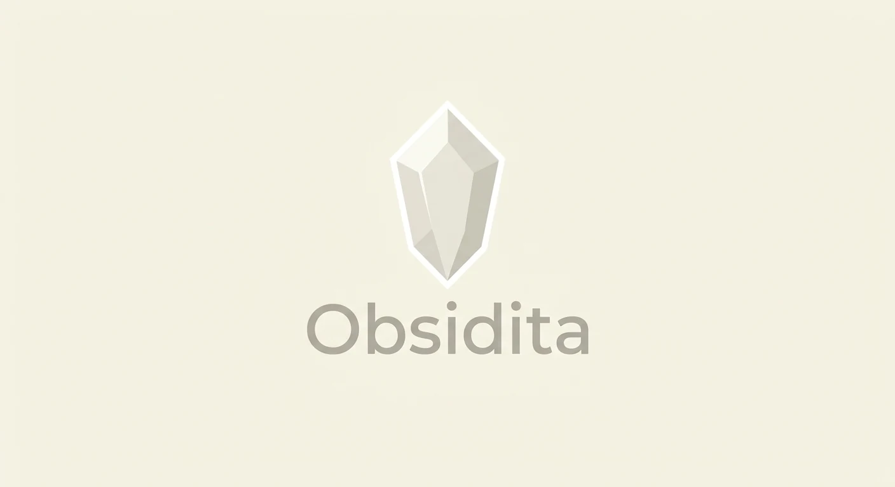
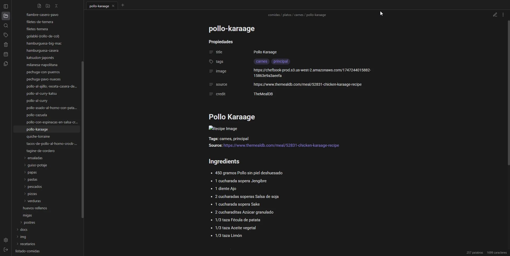

<a id="top"></a>

<p align="center">
  <a href="README.md">🇬🇧 English</a> · <b>🇪🇸 Español</b>
</p>

<p align="center">
  
</p>

<p align="center">
  <a href="https://nodejs.org/"></a>
  <a href="https://www.typescriptlang.org/"></a>
  <a href="https://react.dev/"></a>
  <a href="https://expressjs.com/"></a>
  <a href="https://opensource.org/licenses/MIT"></a>
  <a href="https://claude.com/claude-code"></a>
</p>

---

## 💎 Tu vault de Obsidian, en cualquier navegador

<div align="justify">

**Obsidita** es un visor y editor web **ultraligero** y **autoalojado** para tus notas Markdown. Lo instalas en tu VPS y accedes a tu vault desde cualquier dispositivo, con una interfaz fiel a la de Obsidian.

Obsidita trabaja directamente sobre la carpeta de tu vault: tus notas siguen siendo archivos `.md` normales, sin bases de datos ni formatos propios, y puedes seguir abriéndolas con Obsidian de escritorio. Desde el portátil del trabajo, una tablet o el móvil puedes escribir con vista previa en vivo, navegar por tus wikilinks, buscar en todo el vault, editar propiedades y pegar imágenes, y tus cambios se guardan solos.

Tus notas se quedan en tu servidor, protegidas con contraseña, sesiones revocables y una configuración segura por defecto. Y si quieres llevarlas a otros dispositivos, puedes sincronizarlas con GitHub desde la propia web.

</div>

<p align="center">
  
</p>

> [!TIP]
> **¿Prisa?** `git clone` → `npm install` → `npm start` → abre `http://localhost:3000` y pega el token que aparece en la consola. [Ver instalación ↓](#-instalación)

---

## 📑 Índice

<table>
<tr>
<td valign="top" width="33%">

**Empezar**
- [✨ Características](#-características)
- [🚀 Instalación](#-instalación)
- [🔧 Configuración inicial](#-configuración-inicial)
- [🧩 Variables de entorno](#-variables-de-entorno)

</td>
<td valign="top" width="33%">

**Usar**
- [⌨️ Atajos de teclado](#️-atajos-de-teclado)
- [🔄 Sincronización con GitHub](#-sincronización-con-github)
- [⚠️ Importante](#️-importante)

</td>
<td valign="top" width="33%">

**Referencia**
- [📚 Documentación](#-documentación)
- [🤖 Desarrollado con IA](#-desarrollado-con-ia)
- [📄 Licencia](#-licencia)

</td>
</tr>
</table>

---

## ✨ Características

<table>
<tr>
<td width="50%" valign="top">

### ✍️ Escribe como en Obsidian
- Editor **CodeMirror 6** con **vista previa en vivo** (incluidas tablas) o **modo fuente**.
- **Modo lectura** con resaltado de sintaxis y **diagramas Mermaid**.
- **Autoguardado** mientras escribes, y `Ctrl+S` para forzarlo.
- Si la nota cambia en otro dispositivo, se recarga sola; si tenías cambios sin guardar, eliges qué versión conservar.
- **Propiedades** (frontmatter YAML) editables, con `tags` y `aliases` como listas.

</td>
<td width="50%" valign="top">

### 🔗 Conecta tus ideas
- **Wikilinks**: `[[nota]]`, `[[nota|alias]]` y `[[nota#encabezado]]`.
- Los enlaces a notas inexistentes se ven atenuados y **crean la nota** al pulsarlos.
- **Búsqueda global** en nombres y contenido, con contexto.
- Filtra por etiqueta con `tag:proyecto`.
- Búsqueda dentro de la nota con `Ctrl+F`.

</td>
</tr>
<tr>
<td valign="top">

### 📂 Organiza tu vault
- **Explorador** con carpetas colapsables y menú contextual.
- **Pestañas**: `Ctrl`/`Cmd` + clic o botón central.
- Mueve y renombra: los **enlaces se actualizan** solos.
- Papelera `.trash` desde la que puedes restaurar.
- **Adjuntos**: arrastra o pega imágenes; se guardan donde lo hace Obsidian.
- **Notas diarias y plantillas** con la misma configuración que Obsidian.

</td>
<td valign="top">

### ☁️ Pensado para tu servidor
- **Sincronización con GitHub**, manual o periódica.
- **Exportación a PDF** desde el navegador.
- **Recuento de palabras** y caracteres.
- Tema **oscuro, claro o del sistema**, y fuentes a elegir (también las tuyas).
- Interfaz en **español, inglés o catalán**.

</td>
</tr>
</table>

> [!NOTE]
> 🔒 **Seguro por defecto:** contraseña con `scrypt` · sesiones revocables · límite de intentos de login · protección CSRF · CSP estricta · vault aislado.

---

## 🚀 Instalación

| Necesitas | Detalle |
| :--- | :--- |
| 🟢 **Node.js** | **20 o superior** (20.12+ para que se cargue el `.env`) y el `npm` que trae. |
| 🐙 **git** | **2.31 o superior**, solo si vas a usar la sincronización con GitHub. |
| 📁 **Un vault** | Una carpeta del servidor: un vault existente o una carpeta vacía. |
| 🔐 **En producción** | Un dominio y un proxy inverso con HTTPS (Caddy o nginx). Muy recomendado. |

```bash
git clone https://github.com/loft17/Obsidita.git
cd Obsidita
npm install
npm start
```

<div align="justify">

Abre **`http://localhost:3000`** y sigue la [configuración inicial](#-configuración-inicial). Para desplegarlo en un servidor con systemd, nginx y HTTPS, tienes la guía completa en [Instalación y configuración](docs/es/INSTALACION_Y_CONFIGURACION.md).

</div>

> [!WARNING]
> **No uses `npm install --omit=dev` ni `--production`.** La web se compila con Vite (una dependencia de desarrollo) durante el `postinstall`; sin ella no se genera `web/dist` y la página aparecerá en blanco.

---

## 🔧 Configuración inicial

<div align="justify">

La primera vez que arranca, el servidor imprime en la consola un **token de un solo uso**. Así nadie que llegue a la web antes que tú puede configurarla.

</div>

```text
==================================================
  Token de configuración inicial: 3f9a1c0e7b2d4a6f8e1c9b0d
==================================================
```

1. Abre la web y pega el **token de configuración**.
2. Escribe la **ruta absoluta** de tu vault, por ejemplo `/srv/vaults/mi-vault`.
3. Elige una **contraseña** de al menos **12 caracteres**.
4. Si quieres, cambia el **puerto** (por defecto `3000`).
5. Pulsa **Configurar** e inicia sesión. ¡Listo! 🎉

---

## 🧩 Variables de entorno

<div align="justify">

Al arrancar, el servidor carga el archivo **`.env`** de la carpeta de la app, si existe. Copia la plantilla, ajústala y reinicia. Las variables definidas en la shell, en systemd o en PM2 tienen prioridad sobre las del `.env`.

</div>

```bash
cp .env.example .env && nano .env
```

| Variable | Para qué sirve |
| :--- | :--- |
| `HOST` | En producción, `127.0.0.1`: así solo el proxy inverso puede conectar. |
| `TRUST_PROXY` | Ponla a `1` si hay un proxy inverso delante (Caddy, nginx). |
| `VAULTS_ROOT` | Limita el vault a una carpeta concreta, p. ej. `/srv/vaults`. |
| `UPDATE_CHECK` | Con `0`, el servidor no comprueba si hay versiones nuevas en GitHub. |
| `MAX_UPLOAD_MB`, `MAX_NOTE_MB`… | Límites de tamaño, búsqueda, contraseña y sesiones. |

<div align="justify">

Todas las variables están comentadas en [`.env.example`](.env.example) y explicadas en detalle en [Instalación y configuración](docs/es/INSTALACION_Y_CONFIGURACION.md#-variables-de-entorno).

</div>

---

## ⌨️ Atajos de teclado

| Atajo | Acción |
| :--- | :--- |
| <kbd>Ctrl</kbd>/<kbd>Cmd</kbd> + <kbd>P</kbd> | Abrir una nota rápidamente |
| <kbd>Ctrl</kbd>/<kbd>Cmd</kbd> + <kbd>S</kbd> | Guardar ahora |
| <kbd>Ctrl</kbd>/<kbd>Cmd</kbd> + <kbd>E</kbd> | Alternar edición y lectura |
| <kbd>Ctrl</kbd>/<kbd>Cmd</kbd> + <kbd>Shift</kbd> + <kbd>F</kbd> | Buscar en todo el vault |
| <kbd>Ctrl</kbd>/<kbd>Cmd</kbd> + <kbd>F</kbd> | Buscar dentro de la nota |
| <kbd>Ctrl</kbd>/<kbd>Cmd</kbd> + rueda | Cambiar el tamaño de la letra |

<div align="justify">

La lista completa está en [Atajos de teclado](docs/es/ATAJOS.md).

</div>

---

## 🔄 Sincronización con GitHub

<div align="justify">

Obsidita puede mantener tu vault sincronizado con un repositorio de GitHub y, a través de él, con Obsidian de escritorio usando el plugin **Obsidian Git**. Se configura desde **Preferencias → Sincronización**: indica el repositorio (mejor privado, porque se suben todas las notas), la rama y un **token de acceso personal** limitado a ese repositorio.

Cada sincronización hace commit de los cambios, integra los del repositorio y sube el resultado. Si una nota ha cambiado en los dos lados, se conserva la versión del servidor. Puedes sincronizar a mano o elegir una frecuencia automática, desde cada 5 minutos hasta una vez al día. El token se guarda solo en el servidor y nunca llega al navegador; la papelera `.trash` no se sube.

</div>

---

## ⚠️ Importante

> [!NOTE]
> **Firefox:** algunos campos de texto usan `field-sizing`, que funciona en Chrome, Edge y Safari recientes, pero puede que no en Firefox. Ahí el campo no crece con el texto, aunque sigue ocupando el hueco libre de la línea, así que se puede usar igual.

---

## 📚 Documentación

| Documento | Contenido |
| :--- | :--- |
| 📖 [Guía de uso](docs/es/GUIA_USUARIO.md) | Lo básico para empezar a escribir y organizar tus notas. |
| ⚙️ [Instalación y configuración](docs/es/INSTALACION_Y_CONFIGURACION.md) | Despliegue en producción, nginx, variables de entorno y copias de seguridad. |
| ⌨️ [Atajos de teclado](docs/es/ATAJOS.md) | Todos los atajos disponibles. |
| 🩺 [Errores y soluciones](docs/es/ERRORES_Y_SOLUCIONES.md) | Problemas frecuentes y cómo resolverlos. |
| 🪶 [Recursos limitados](docs/es/OPTIMIZACION_RECURSOS_LIMITADOS.md) | Cómo ajustarlo para servidores pequeños. |
| 🧰 [Scripts listos](docs/es/SCRIPTS_LISTOS.md) | Scripts para instalar, actualizar y mantener la app. |
| 🏗️ [Arquitectura](docs/es/ARQUITECTURA.md) | Cómo está organizado el código. |
| 🔌 [API HTTP](docs/es/API.md) | Endpoints del servidor. |
| 🤝 [Contribuir](CONTRIBUTING.md) | Cómo levantar el proyecto en local y proponer cambios. |

<div align="justify">

🇬🇧 La documentación también está disponible en inglés en [docs/en](docs/en/).

</div>

---

## 🤖 Desarrollado con IA

<div align="justify">

Obsidita se ha desarrollado con ayuda de **[Claude](https://claude.com/claude-code)**, la IA de Anthropic, usando Claude Code: tanto el código como la documentación se han escrito y revisado en colaboración con ella.

</div>

---

## 📄 Licencia

<div align="justify">

Distribuido bajo la licencia [MIT](https://opensource.org/licenses/MIT).

Obsidita es un proyecto independiente y no está afiliado, patrocinado ni respaldado por Obsidian ni por Dynalist Inc. «Obsidian» es una marca de sus respectivos propietarios y se menciona aquí solo para indicar compatibilidad.

</div>

---

<p align="center">
  Hecho con 💜 para quienes viven en su vault de Obsidian.<br><br>
  <a href="#top"><b>⬆ Volver arriba</b></a>
</p>
